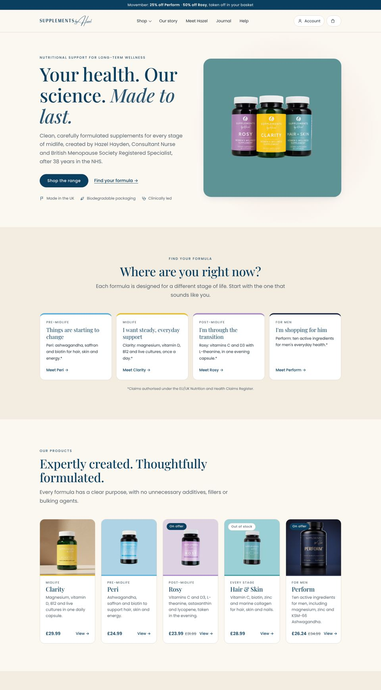

# supplementsbyhazel.com: the redesign

The new Supplements by Hazel website, built the same way as Perform for Men:
hand-written HTML and CSS, with Wix running the products, basket, checkout, accounts, blog and forms
through the same storefront modules in `public/js/wix/`.



## Layout

| Path | What it is |
| --- | --- |
| `src/pages/*.html` | Page bodies (home, about, blog, post, help, account, thank-you, legal, 404). Each starts with a `<!--meta {...} -->` block. |
| `data/catalog.py` | Every product's copy: ingredients, claims, FAQs, and the Wix slugs of its 1/3/6 pack products. |
| `data/posts.json` | The blog list as a no-JavaScript fallback and for the sitemap. Live posts come from Wix Blog. |
| `build.py` | Wraps pages in the shared header, footer, basket and newsletter; generates the shop and product pages, `sitemap.xml`, `robots.txt` and `redirects.json`. |
| `public/` | The site as deployed. `css/`, `js/` and `assets/` are hand-written; the `.html` files are generated. |
| `redirects.json` | Old Wix URLs to the new pages, to set up as 301s when deploying. |

Rebuild after editing `src/` or `data/`:

```bash
python3 build.py
```

## How the shop works

Prices, stock and Subscribe & save plans are read live from Wix Stores, so changing a price or a
discount in the Wix dashboard changes the site with no rebuild. In Hazel's store each pack size is
its own product (`clarity`, `clarity-3-tubs-save-10`, `clarity-6-tubs-save-15`, and so on), each with
a 5% subscription plan; the buy box (`public/js/shop.js`) lists them as the supply choices.

Change the announcement bar in `build.py` (`ANNOUNCE`).

## Deploying

The site is live at https://www.supplementsbyhazel.com (Wix Go Headless migration completed
11 Nov 2026). To release a change, follow `deploy/README.md`.

`public/js/wix/config.js` holds the site's public client id. It is not a secret.
